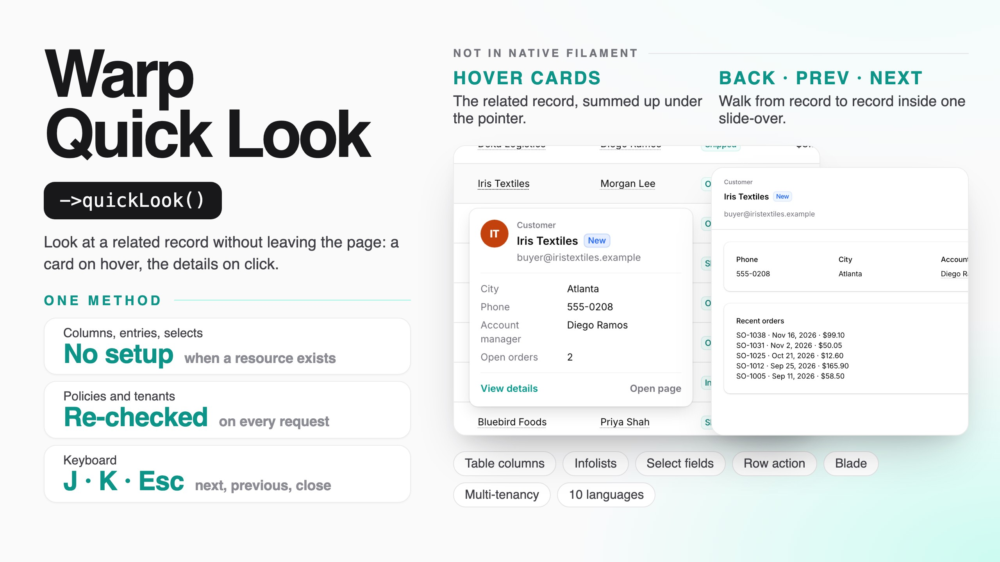
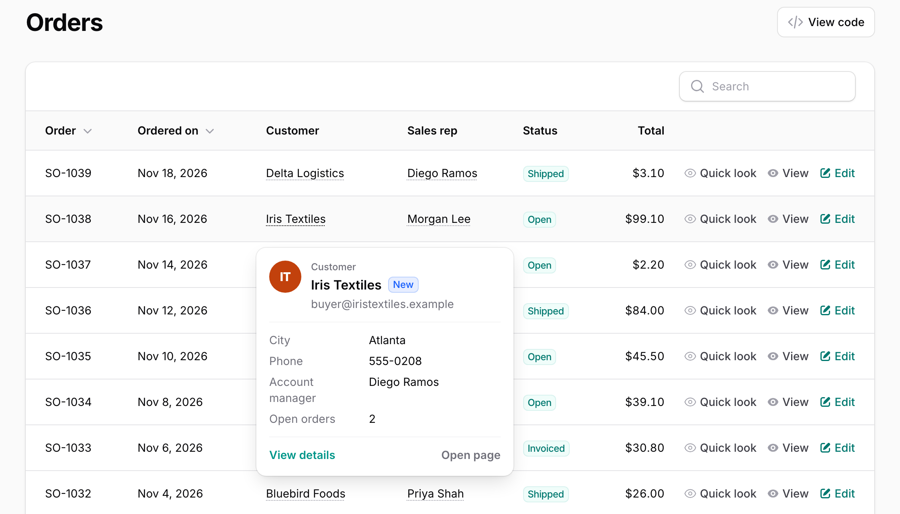
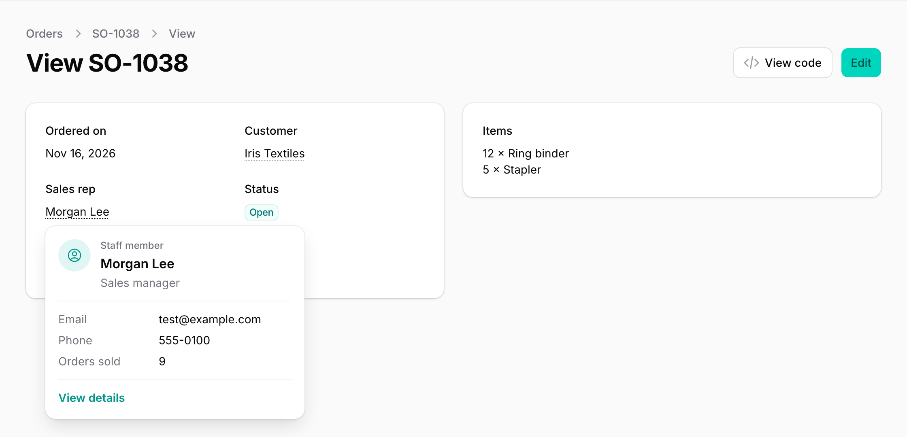
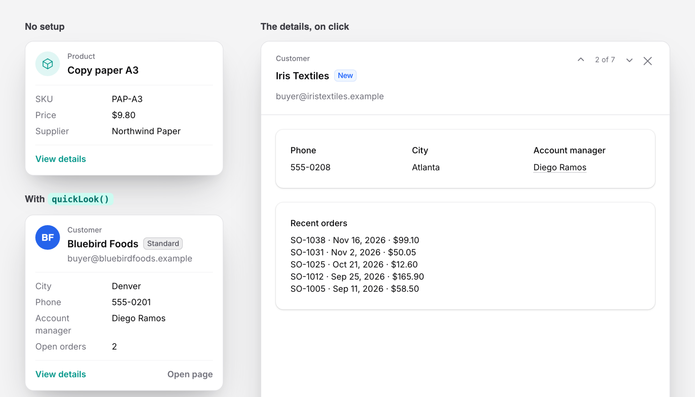
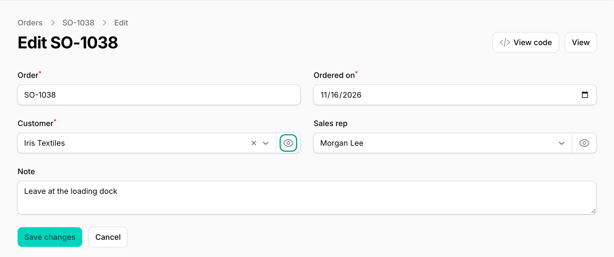

# Warp Quick Look

**See a related record without leaving the page. Put the cursor on a customer's name in a table, an infolist or a form and a small card appears; click it and the full details slide in from the side. Close it and your screen is exactly as you left it — the filters, the scroll position and the half-typed form are still there. You add one method to a column and write the card once per model.**

<a href="https://demo.warpui.com/quicklook"></a>

Hover a customer in a list of orders, click to open the details, step to the next customer with J and K, open the account manager from inside the customer and go back — at **[demo.warpui.com/quicklook](https://demo.warpui.com/quicklook)**. No sign-up needed; the data is reset every hour.



- [What it does](#what-it-does)
- [Installation](#installation)
  - [AI coding assistants (Laravel Boost)](#ai-coding-assistants-laravel-boost)
- [Quick start](#quick-start)
- [Table columns and infolist entries](#table-columns-and-infolist-entries)
- [Describing a card: `QuickLook`](#describing-a-card-quicklook)
- [Models without a resource](#models-without-a-resource)
- [Select fields: the eye button](#select-fields-the-eye-button)
- [Table row action](#table-row-action)
- [Anywhere else: Blade and other plugins](#anywhere-else-blade-and-other-plugins)
- [Outside a panel](#outside-a-panel)
- [What the viewer sees](#what-the-viewer-sees)
- [Panel settings](#panel-settings)
- [Multi-tenancy](#multi-tenancy)
- [Permissions](#permissions)
- [Security](#security)
- [Translations](#translations)
- [Testing](#testing)
- [Limitations](#limitations)
- [Requirements](#requirements)
- [Support](#support)
- [License](#license)

## What it does

| You want… | Use |
| --- | --- |
| A hover card and a slide-over for the customer shown in a table column | [`TextColumn::make('customer.name')->quickLook()`](#table-columns-and-infolist-entries) |
| The same in an infolist | [`TextEntry::make('customer.name')->quickLook()`](#table-columns-and-infolist-entries) |
| To choose what the card and the slide-over show | [`public static function quickLook(QuickLook $quickLook)`](#describing-a-card-quicklook) |
| To show a model that has no Filament resource | [`->look(Supplier::class, fn (QuickLook $look) => …)`](#models-without-a-resource) |
| A way to look at the customer picked in a `Select`, before saving | [`Select::make('customer_id')->quickLook()`](#select-fields-the-eye-button) |
| An action button on every table row | [`QuickLookAction::make()`](#table-row-action) |
| Only the card, or only the click | [`->quickLook(slideOver: false)`, `->quickLook(card: false)`](#table-columns-and-infolist-entries) |
| The same behavior in your own Blade view or another plugin's output | [`<x-warp-quicklook::link>`, `QuickLook::attributes()`](#anywhere-else-blade-and-other-plugins) |

Warp Quick Look:

- **works without configuration.** If the model has a resource in the panel, `->quickLook()` is enough: the card shows the record title and the details of the global search result, and the slide-over shows the infolist of the resource (the same one the standard view action shows).
- **keeps the page as it is.** There is no page change and no full-page modal. The card and the slide-over are rendered by one Livewire component that lives at the end of the page, so filters, sorting, scroll position and unsaved form input stay.
- **is read-only.** It is for looking. There is no editing in the slide-over; “Open page” takes the viewer to the resource page.
- **checks permissions and tenant every time.** A record the viewer may not see gets no underline and no card. See [Permissions](#permissions) and [Security](#security).
- **works where Filament renders columns, entries and fields:** tables, infolists, relation managers, repeaters, tabs, wizards, action modals (it opens on top of them), and in SPA mode. Light and dark mode, the keyboard and the width of a phone are covered.
- **speaks ten languages** (English, Japanese, German, French, Spanish, Italian, Brazilian Portuguese, Korean, simplified and traditional Chinese).

Warp Quick Look shows records you point at; it does not edit them and it does not draw two panes side by side.

## Installation

> **Warp Quick Look is a commercial plugin.** A license is required. After purchase you receive credentials for the private Composer repository.

```bash
composer config repositories.qalainau composer https://qalainau.privato.pub/composer
composer config --auth http-basic.qalainau.privato.pub "your-email" "your-license-key"

composer require qalainau/filament-warp-quicklook
php artisan filament:assets
```

There is nothing to publish and no migration: Warp Quick Look has no tables of its own. Register the plugin on every panel where you want it. It places its Livewire component at the end of the page by itself:

```php
use Qalainau\FilamentWarpQuickLook\FilamentWarpQuickLookPlugin;

$panel->plugin(FilamentWarpQuickLookPlugin::make());
```

Run `php artisan filament:assets` again after each update of the plugin.

### AI coding assistants (Laravel Boost)

Warp Quick Look ships instructions for AI coding assistants such as Claude Code, Cursor and Codex. If your app uses
[Laravel Boost](https://laravel.com/docs/boost), the assistant learns from them to reach for `->quickLook()` instead of hand-writing a `slideOver()` action per column, how to describe a card, and how to test it.

- **Guidelines** (`resources/boost/guidelines/core.md`): a short summary that Boost adds to `CLAUDE.md`, `AGENTS.md` and the other agent files. It also points the assistant to this README in `vendor/`, so it reads the documentation of the version you have installed.
- **Skill** `warp-quicklook-development` (`resources/boost/skills/`): an example for every part, and tests. The assistant loads it when it works on Quick Look.

When `php artisan boost:install` asks "Which third-party AI guidelines/skills would you like to install?", select `qalainau/filament-warp-quicklook`. To do it without the question, add the package to `boost.json` and run the command again:

```json
{
    "packages": ["qalainau/filament-warp-quicklook"]
}
```

```bash
php artisan boost:install --guidelines --skills -n
```

## Quick start



Register the plugin (above), then add `->quickLook()` to the column that shows the related record:

```php
use Filament\Tables\Columns\TextColumn;

TextColumn::make('customer.name')->quickLook(),
```

The name `customer.name` tells Quick Look to follow the `customer` relationship of each row. The customer name now has a dotted underline. Put the cursor on it for 300 ms and a card appears; click it and the details slide in. With the keyboard: Tab to it and press Enter or Space (in a table whose rows are links, Tab stops on the row link of the cell and Space opens the details; see [The slide-over](#the-slide-over)). This works because the panel has a `CustomerResource`.

To choose what the card shows, add a `quickLook()` method to that resource:

```php
use Filament\Support\Icons\Heroicon;
use Qalainau\FilamentWarpQuickLook\QuickLook;

public static function quickLook(QuickLook $quickLook): QuickLook
{
    return $quickLook
        ->description('email')
        ->icon(Heroicon::OutlinedBuildingOffice)
        ->details([
            'Phone' => 'phone',
            'Open orders' => fn (Customer $record) => $record->orders()->open()->count(),
        ]);
}
```

Every table, infolist and select that points at a customer shows this card from now on.

## Table columns and infolist entries



`quickLook()` is available on every table column and every infolist entry (`TextColumn`, `ImageColumn`, `IconColumn`, `TextEntry`, `ImageEntry`, `IconEntry`, …). It adds a few HTML attributes and the class `fi-warp-quicklook-mark` to the root element of the column or entry; it does not change what the column shows and it keeps the `extraAttributes()` you wrote. (Because the column now has extra attributes, Filament renders a `TextColumn` through its regular path instead of its shortcut for plain text; the output is the same.)

```php
use Filament\Infolists\Components\TextEntry;
use Filament\Tables\Columns\TextColumn;

// Follow the relationship in front of the last dot of the column name
TextColumn::make('customer.name')->quickLook(),

// No dot: the record of the row itself (an order number that opens the order)
TextColumn::make('number')->quickLook(),

// Name the relationship (dots follow a chain: 'order.customer')
TextColumn::make('total')->quickLook('customer'),

// Return the record yourself
TextEntry::make('approved_by_name')->quickLook(fn (Order $record) => $record->approver),

// Only the card, or only the click
TextColumn::make('customer.name')->quickLook(slideOver: false),
TextColumn::make('customer.name')->quickLook(card: false),
```

`quickLook(string | Closure | null $record = null, bool $card = true, bool $slideOver = true, string $cardAnchor = 'text')`

| Argument | Meaning |
| --- | --- |
| `$record` | `null`: follow the relationships in the column name, or use the row itself when the name has no relationship. A string: the name of a relationship that returns one record (`'customer'`, `'order.customer'`). A closure: return the record (the usual Filament injection works: `$record`, `$state`, `$livewire`, …). |
| `$card` | `false`: no hover card; the click still opens the slide-over. |
| `$slideOver` | `false`: only the card; the click does nothing special. |
| `$cardAnchor` | `'text'` (default): place the card next to the visible text. `'column'`: use the table column edge, leaving a clear vertical path through its rows. Works per column or entry; entries without a table cell use the component bounds. Other values throw a `LogicException`. |

Both `card: false` and `slideOver: false` together do nothing.

### Which relationships work

Relationships that return **one** record: `BelongsTo`, `HasOne`, `MorphOne`, `HasOneThrough` and `MorphTo`. For a `MorphTo` the look is chosen by the type of the record, so one column can show customers in one row and suppliers in another.

### In-between cases

- **The relationship is empty** (the order has no sales rep): nothing is added, the cell looks as before.
- **The viewer may not see the record, or there is no look for its model** (a `MorphTo` that points at a model you have not described): nothing is added.
- **A relationship that returns many records** (`HasMany`, `BelongsToMany`): not supported, the column is shown as before. See [Limitations](#limitations).
- **The model is known but has no look** — the relationship is `BelongsTo Customer`, the row itself, or a closure that returned a customer, and the panel has no way to show a customer — is a setup mistake. Quick Look throws a `LogicException` when the page is drawn, and the message says how to fix it: add a resource for the model, or describe it with `->look(…)` (outside a panel, `QuickLook::register()`).
- **A name that is not a relationship** (`quickLook('total')`) throws a `LogicException` that names the model and the name.
- **Column names with JSON paths** (`meta.name`): the lookup stops at the first part that is not a relationship, so the row itself is used.

### Looking through the table

When you open the slide-over from a column of a table (or with `QuickLookAction`), the records of the **same column of the same table that are on the screen** can be stepped through: **Previous** and **Next** buttons, a position (“3 of 25”), and the keys ↑ ↓ or J K (not while typing in a field). A record that appears in several rows is visited once, so the number can be smaller than the number of rows; pointing at the position says so. Records the viewer may no longer see, or that were deleted meanwhile, are skipped. At most 500 records are remembered. There is no previous/next for infolist entries, selects and the Blade component, and none after you went deeper into a related record.

## Describing a card: `QuickLook`



You describe how a model looks **once, per model**, and every column, entry and select that points at that model shows the same card. For a model with a resource, add a static `quickLook()` method to the resource:

```php
use Filament\Actions\Action;
use Filament\Schemas\Components\Section;
use Filament\Support\Enums\Width;
use Filament\Support\Icons\Heroicon;
use Qalainau\FilamentWarpQuickLook\QuickLook;

public static function quickLook(QuickLook $quickLook): QuickLook
{
    return $quickLook
        ->title(fn (Customer $record) => $record->name)
        ->description('email')
        ->image(fn (Customer $record) => $record->avatar_url)
        ->icon(Heroicon::OutlinedBuildingOffice)
        ->badge(fn (Customer $record) => $record->status->getLabel(), color: fn (Customer $record) => $record->status->getColor())
        ->details([
            'Phone' => 'phone',
            'Open orders' => fn (Customer $record) => $record->orders()->open()->count(),
        ])
        ->schema([
            Section::make()->columns(2)->schema([
                TextEntry::make('name'),
                TextEntry::make('email'),
            ]),
        ])
        ->actions([
            Action::make('email')->label('Send email')->url(fn (Customer $record) => 'mailto:'.$record->email),
        ])
        ->openUrl(fn (Customer $record) => route('crm.customers.show', $record))
        ->width(Width::ThreeExtraLarge);
}
```

Everything is optional. What you leave out comes from the resource: the title from `getRecordTitle()`, the details from `getGlobalSearchResultDetails()`, the type name from the model label, the icon from the navigation icon, the slide-over from the resource `infolist()` (or its `form()` with every field disabled and filled, like the standard view action; a resource with neither lists the attributes of the record), and “Open page” from the resource's view page, then its edit page, whichever the viewer may open.

| Method | What it sets |
| --- | --- |
| `title($attribute \| Closure)` | The heading of the card and the slide-over. A string is the name of an attribute (dots follow relationships: `'customer.name'`). |
| `description($attribute \| Closure)` | One line under the heading. |
| `image($attribute \| Closure)` | A round picture. Only `http(s)` URLs and paths starting with `/` are used. |
| `icon($icon \| Closure)` | Shown when there is no image. Heroicon enums, icon names and `Htmlable` icons work. |
| `badge($label, color: …)` | A badge next to the heading. The color is a Filament color name (`success`, `danger`, …); anything else is gray. A `null` label shows no badge. |
| `details(['Label' => 'attribute' \| Closure])` | The “label: value” rows of the card (up to 12). Rows whose value is `null` or empty are left out. To translate the labels, pass a closure that returns the array: `->details(fn (Customer $record) => [__('Phone') => $record->phone])`. In that array the values are used as they are (not as attribute names); closures inside it are still called. |
| `schema([…])` | What the slide-over shows: any infolist components. It also takes a closure. Replaces the infolist of the resource. |
| `actions([…])` | Buttons at the bottom of the slide-over. They get the record (`fn (Customer $record) => …`) and may open modals. |
| `openUrl(string \| Closure \| false)` | Where “Open page” goes. `false` hides it. |
| `width(Width \| string)` | The width of the slide-over for this model. |
| `label(string \| Closure)` | The small type name above the heading (“Customer”). Default: the model label of the resource with a capital first letter, or the class name of the model. |

Values can be an attribute name or a closure that gets the record, as `$record` or typed by its model class.

The card is built as plain data: titles, descriptions, details and badges are turned into text (enums, dates, booleans, `Htmlable` values and arrays are converted, HTML tags are removed). Dates are written the way the app's locale writes them (“Nov 13, 2026” in English, “13. Nov 2026” in German) in the Filament timezone, with the time when it is not midnight. Titles are cut at 200 characters, descriptions and detail values at 300, detail labels and the type name at 80, badges at 60. You cannot put custom HTML in the card; use `schema()` for the slide-over.

### The slide-over

- **Opening:** click, or Enter or Space on a focused mark. Ctrl or ⌘ + click opens the “Open page” URL in a new tab instead (also on a column with its own `url()`). A click is handled before a row URL (`recordUrl()`), a column `url()` or a row action sees it, so the page does not change.
- **Keyboard in tables whose rows are links:** a table with a `recordUrl()` or `recordAction()` (any resource table with a view or edit page) wraps every cell in a link. A focusable element inside a link is not valid HTML, so there the mark is not a separate tab stop: Tab stops on the cell link as usual, the card appears with “Press Space to view details”, **Space** opens the details and Enter still follows the row link. The same holds for a column or an entry with its own `url()`.
- **Going deeper:** a related record inside the slide-over, marked with `quickLook()` in your `schema()`, **replaces** the content and a “Back to …” link appears. Slide-overs are never stacked on each other.
- **Footer:** the `actions()` you gave, and “Open page”.
- **Closing:** Esc, the close button, or a click outside. Focus returns to the element that opened it, or, after Previous or Next, to the mark of the record that was shown (when it is on the page).
- **On touch screens** there is no hover: a tap opens the slide-over directly. On a phone, the slide-over is full width.
- **From inside another modal** (an action modal with an infolist, for example) it opens on top. Esc closes only the slide-over, and focus returns into the modal. An action modal opened from the slide-over's own buttons sits on top of it, and Esc closes that first.
- **When the record goes away** while the slide-over is open (deleted, or the permission was taken away), the next request shows “This record could not be found.” instead of failing.

### The card

- It appears after the cursor rests on the mark for 300 ms, or when the mark (or the row link around it) receives focus from the keyboard. It does not appear for focus that comes from a mouse click or from a modal moving focus into itself. It can be entered with the cursor, and closes 150 ms after the cursor leaves, when the page scrolls, or with Esc.
- It shows a placeholder while loading. If the record is gone or the viewer may no longer see it, it says so: “This record could not be found. It may have been deleted, or you may not have access to it.”
- Cards are remembered in the browser for 30 seconds (`cacheFor()`), and forgotten as soon as another Livewire component on the page finishes a request or the slide-over closes, so a value you just saved is not shown stale. A card that turns out to be missing is not remembered. If you move to another mark while a card is loading, the late answer is thrown away.

## Models without a resource

If a model has no resource in the panel, tell the plugin how to show it:

```php
use Qalainau\FilamentWarpQuickLook\FilamentWarpQuickLookPlugin;
use Qalainau\FilamentWarpQuickLook\QuickLook;

$panel->plugin(
    FilamentWarpQuickLookPlugin::make()
        ->look(Supplier::class, fn (QuickLook $look) => $look
            ->title('name')
            ->description('city')
            ->details(['Phone' => 'phone', 'Terms' => 'payment_terms'])
            ->query(fn () => Supplier::query()->where('active', true))
            ->authorize(fn (Supplier $record) => auth()->user()->can('view', $record))),
);
```

A look in the plugin is also used **instead of** the resource's, in that panel, when both exist.

Without a resource there is no infolist to borrow, so:

- the title comes from the first filled attribute of `name`, `title`, `label`, `number`, `email` (else “Supplier #12”);
- the slide-over lists the attributes of the model as “label: value” rows, without keys (`*_id`), timestamps, `deleted_at` and hidden attributes; use `schema()` to choose your own;
- there is no “Open page” unless you set `openUrl()`.

Extra methods for these models:

| Method | Meaning |
| --- | --- |
| `query(Closure)` | The query that finds the record. Default: `Supplier::query()`. |
| `authorize(Closure)` | Who may see it. Default: the `view` ability of the model's policy; **with no policy, everyone may see it** — in a panel that means everyone signed in to the panel, outside a panel (`QuickLook::register()`) also guests. |
| `scopedToTenant(false)` | In a panel with tenancy, for a model that does not belong to a tenant. See [Multi-tenancy](#multi-tenancy). |

## Select fields: the eye button



```php
use Filament\Forms\Components\Select;

Select::make('customer_id')->relationship('customer', 'name')->quickLook(),

// A select whose options do not come from relationship()
Select::make('owner_id')->options(fn () => User::query()->pluck('name', 'id')->all())->quickLook(model: User::class),
```

`quickLook(?string $model = null)` adds an eye button at the end of the field. Hovering over it or focusing it with the keyboard shows a compact preview of the **currently selected** record, including a choice that has not been saved yet. Use **View details** inside the card to open the slide-over. The form keeps everything that was typed. When nothing is selected the button is hidden.

While the dropdown is open, hover an option or move through the candidates with the arrow keys to preview that record **before selecting it**. The dropdown stays open and the field value stays unchanged until you click an option or press Enter. Search results work the same way. `quickLook()` uses Filament's custom dropdown (`native(false)`) so candidate previews are available even on fields without search.

- The model comes from `relationship()`. Without it you must pass `model:`; otherwise a `LogicException` explains it.
- A multiple select gets no button.
- It also works on a disabled select (a view page that shows the form disabled), in repeaters (each item opens its own record, also after reordering) and on a create page before the record exists.
- The button asks for “a record of this kind”, and the server checks that the chosen record is one the viewer may see — the same as for a table cell: a record of another tenant, or a forbidden one, shows “This record could not be found.” Note what this means: the button can open **any** record of that model that the viewer may view (the look's query and permission), not only the options of this select. If the options are narrower than what the viewer may see elsewhere — say, only active customers — a visitor who edits the request can still open an inactive customer they are allowed to view. Hide such records with the look's `query()`/`authorize()` (or the resource's `getEloquentQuery()` and policy) if they must not be seen.
- A model that has no look gives a `LogicException` (as for columns) when `model:` was passed or can be read from `relationship()`.
- No click is needed to preview. On a touch screen, tap the eye. Escape dismisses the preview. Select previews have no previous/next.

## Table row action

```php
use Qalainau\FilamentWarpQuickLook\Actions\QuickLookAction;

$table->recordActions([QuickLookAction::make(), EditAction::make()]);
```

An eye button on every row that opens the slide-over of the row's record (no card). The visitor can then step through the other rows of the table with Previous and Next. The button is hidden for rows the viewer may not see, or for a model with no look. It is a normal Filament action: `->label()`, `->icon()`, `->color()` and the rest work, but it never calls a Livewire action — the click is handled in the browser and the slide-over is requested from the server.

## Anywhere else: Blade and other plugins

Your own Blade view, a Livewire page, the output of another package:

```blade
<x-warp-quicklook::link :record="$customer">{{ $customer->name }}</x-warp-quicklook::link>

<x-warp-quicklook::link :record="$customer" :card="false">{{ $customer->name }}</x-warp-quicklook::link>
```

The component takes `record`, `card` and `slide-over` (booleans, default on). It renders a `<span class="fi-warp-quicklook-link">` with the Quick Look attributes and merges the classes and attributes you give it. When the record cannot be shown, the span has no Quick Look attributes, so the slot reads as plain text.

For anything that lets you add HTML attributes to an element:

```php
use Qalainau\FilamentWarpQuickLook\QuickLook;

QuickLook::attributes($customer);                 // ['class' => 'fi-warp-quicklook-mark', 'data-warp-quicklook' => '…', 'tabindex' => '0', …]
QuickLook::attributes($customer, card: false);    // only the click
QuickLook::attributes(null);                      // []
```

`QuickLook::attributes()` returns an empty array when the record is `null`, has no look or may not be seen, so you can pass the result to `$attributes->merge()` without checking. The values are not HTML-escaped; Blade does it for you, and anything else must escape them. `QuickLook::token($record)` returns the signed token alone, or `null`.

Only the markup is provided. Warp Quick Look does not change other Warp plugins; you connect the two where you render their cells.

## Outside a panel

On a plain Livewire page (not a Filament panel page), register the model in a service provider and put the host component in the layout once:

```php
use Qalainau\FilamentWarpQuickLook\QuickLook;

// AppServiceProvider::boot()
QuickLook::register(Supplier::class, fn (QuickLook $look) => $look->title('name')->description('city'));
```

```blade
<body>
    {{ $slot }}

    <x-warp-quicklook::host />

    @livewire('notifications')
    @filamentScripts
</body>
```

The page needs Filament's CSS and JavaScript because the slide-over uses Filament's modal: set the page up as Filament describes for using its components outside a panel (Filament's CSS in your app's stylesheet, `@filamentStyles` and `@filamentScripts` in the layout). Without them the card and the slide-over work but are not styled. Outside a panel there is no login requirement of Quick Look's own: the look's `authorize()`, or the model's policy, decides (with no policy, guests may look too). There is no “Open page” unless you set `openUrl()`. Inside a panel, `QuickLook::register()` is used only for models that neither the plugin nor a resource describes.

## What the viewer sees

- **The mark:** a dotted underline under text (images, icons and badges get the pointer cursor only), a pointer cursor and keyboard focus (`tabindex="0"`, `role="button"`, `aria-haspopup="dialog"`; inside a row link the link keeps the focus, see [The slide-over](#the-slide-over)). `->indicator(false)` removes the underline.
- **Nothing to see, nothing marked:** records that are empty, forbidden, or have no look get no underline, no card and no click behavior.
- **Light and dark mode, and the width of a phone** are covered. Colors come from Filament's color variables.
- **The page keeps its state** under the slide-over, because nothing on the page is reloaded.

## Pinning, comparing, and copying

Hover a record and use the pin button in the card header to keep its preview visible while you continue working. One preview can be pinned at a time. The dock stays in the lower corner when you scroll; its heading collapses or expands it, and **Unpin preview** removes it. Pins belong to the current page and are cleared on navigation, including SPA navigation.

With a preview pinned, hover a different record of the same model and choose **Compare with pinned**. A Filament modal aligns their descriptions, badges, and preview detail fields. Rows with different displayed values are highlighted; a field present on only one record shows a dash on the other side. This compares the card data, not every attribute or the full resource infolist. Both records are fetched again through the usual authorization and tenant checks when comparison opens.

Copy icons beside descriptions and detail values work in the hover card, pinned preview, and comparison table. They use Filament’s standard copy component, including keyboard controls and success/failure feedback. Existing `TextEntry::copyable()` and `TextColumn::copyable()` configurations in your resource remain independent.

No additional configuration is required. The demo’s “Pin & compare” page has a separate example for each operation.

## Panel settings

All optional:

```php
use Filament\Support\Enums\Width;

FilamentWarpQuickLookPlugin::make()
    ->look(Supplier::class, fn (QuickLook $look) => $look->title('name'))
    ->hoverDelay(300)                    // milliseconds before the card appears
    ->cacheFor(30)                       // seconds a card is remembered; 0 asks every time
    ->hoverCards(false)                  // no cards in this panel; a click opens the slide-over
    ->indicator(false)                   // no dotted underline
    ->slideOverWidth(Width::TwoExtraLarge);
```

`slideOverWidth()` is the default; a model's `width()` wins.

## Multi-tenancy

Quick Look follows Filament's multi-tenancy.

- **Models with a resource:** records are found with the resource's own query, scoped to the current tenant the way Filament scopes it. A resource with `$isScopedToTenant = false` is not scoped.
- **Models without a resource:** in a panel with tenancy, the records are limited with the panel's ownership relationship (for a `Team` tenant, a `team` relationship on the model). If the model has no such relationship, Quick Look throws a `LogicException` instead of showing records of everybody. You then choose:

```php
// The model does not belong to a tenant at all
->look(Country::class, fn (QuickLook $look) => $look->title('name')->scopedToTenant(false))

// You limit the records yourself
->look(Note::class, fn (QuickLook $look) => $look->title('body')->query(fn () => Note::query()->whereBelongsTo(Filament::getTenant())))
```

  With `query()`, limiting to the tenant is up to the closure.
- **When the tenant is not known** (no tenant selected), no record is shown.
- Tokens are tied to the tenant they were made for. A token from one tenant's screen does not work in another's.

### Testing with tenancy

A token is signed with the panel and the tenant it was made in, so in a test set both before you make a token:

```php
use Filament\Facades\Filament;
use Qalainau\FilamentWarpQuickLook\Livewire\QuickLookHost;
use Qalainau\FilamentWarpQuickLook\QuickLook;

use function Pest\Livewire\livewire;

it('does not show a customer of another team', function () {
    $this->actingAs($user);

    Filament::setCurrentPanel(Filament::getPanel('team'));
    Filament::setTenant($theirTeam, isQuiet: true);
    $theirToken = QuickLook::token($theirCustomer);

    Filament::setTenant($myTeam, isQuiet: true);
    app()->forgetInstance(\Qalainau\FilamentWarpQuickLook\QuickLookManager::class);

    livewire(QuickLookHost::class)
        ->call('card', $theirToken)
        ->assertReturned(['missing' => true]);
});
```

(`QuickLookManager` remembers the look and the permission for the length of a request; call `app()->forgetInstance()` after you switch the panel or tenant inside one test.)

## Permissions

Whether a record may be seen is decided for every cell, card and slide-over, and again when the browser asks for it:

- **A model with a resource:** the resource's `canView($record)`. In practice, the `view` ability of the policy (or whatever `getViewAuthorizationResponse()` does in your resource).
- **A model without a resource:** `authorize()`, or the `view` ability of the model's policy if it has one, or everyone logged in if it has not.
- **`authorize()` on a resource's look** adds a second condition; both must pass.
- Visitors who are not logged in see nothing in a panel.

A record the viewer may not see is simply not marked; the cell looks exactly like a column without Quick Look.

“Open page” is shown only if the viewer may open that page (the view page if the viewer can view, else the edit page if the viewer can edit). Without a page, the link is left out.

## Security

- **Signed tokens.** The cell does not carry the record's ID in the clear. It carries a token made on the server when the page is drawn: the kind of record, the record key, and a signature (HMAC-SHA256 with your `APP_KEY`, mixed with the panel id and the current tenant). Only records you put `quickLook()` on can be asked for. Changing the key or the kind makes the signature fail.
- **Everything is checked again on every request.** A valid token is not a permission. For each request — card, open, go deeper, step, go back — the server finds the record again with the look's own query (scoped to the tenant) and checks the view permission. A wrong signature, a record that cannot be found, a record of another tenant and a record the viewer may not see all give the same answer, “not found”, so no one learns whether a record exists. No exception is thrown.
- **The state of the slide-over** (the open records, the previous/next list, the position) is locked in Livewire and also re-checked on each use. Only the token strings are kept, never the records.
- **Length and shape limits:** keys longer than 255 characters, or not in the shape of the key (numbers for integer keys, a UUID or ULID for models with `HasUuids` or `HasUlids`), are refused before the database is touched. Any other key that the database rejects (a string sent to a `uuid` column, for example) is looked up inside a savepoint and answered with “not found”, so the rest of the request and the transaction around it keep working; the previous/next list is limited to 500 well-formed tokens; the “go deeper” history to 20.
- **The eye button of a select** carries a “any record of this kind” token (signed, so only for models you wrote `quickLook()` on); the record key that the browser sends with it is checked by the look's query and the view permission, like any other.
- **Text, not HTML.** The card is drawn in the browser from plain text; nothing from your data is inserted as HTML. Image and “Open page” URLs are only used if they are `http(s)` URLs or start with `/`. Badge colors are accepted only as Filament color names.
- **Your `schema()` and `actions()`** are normal Filament components in the Livewire component of the host, with Filament's usual protections. Authorization of an action inside them is yours, as everywhere in Filament.

The demo shares one user between all visitors by design; your app does not.

## Translations

The plugin has ten languages: English, Japanese, German, French, Spanish, Italian, Brazilian Portuguese, Korean, simplified Chinese and traditional Chinese. It follows the locale of the app. To change a text, publish the translations:

```bash
php artisan vendor:publish --tag=filament-warp-quicklook-translations
```

The files go to `lang/vendor/warp-quicklook`, where they override the plugin's. The strings are under the `warp-quicklook::quicklook` namespace (the buttons, the “not found” message, the keyboard hint and the “3 of 25” position). The texts you write — titles, details, badge — are yours to translate. The date format of values follows the locale and the Filament timezone.

To change the markup of the slide-over or the Blade components, publish the views (`php artisan vendor:publish --tag=warp-quicklook-views`, to `resources/views/vendor/warp-quicklook`). Published views do not receive the changes of later versions.

## Testing

The card and the slide-over come from one Livewire component, `QuickLookHost`. Test your `quickLook()` definitions by asking it for the card:

```php
use Qalainau\FilamentWarpQuickLook\Livewire\QuickLookHost;
use Qalainau\FilamentWarpQuickLook\QuickLook;

use function Pest\Livewire\livewire;

it('shows the key figures of a customer', function () {
    $this->actingAs($manager);
    Filament::setCurrentPanel(Filament::getPanel('admin'));

    livewire(QuickLookHost::class)
        ->call('card', QuickLook::token($customer))
        ->assertReturned(fn (array $card) => $card['title'] === 'Acme' && $card['details'][0]['label'] === 'Phone');
});

it('opens the slide-over', function () {
    livewire(QuickLookHost::class)
        ->call('open', QuickLook::token($customer))
        ->assertSet('missing', false)
        ->assertSee('Acme');
});
```

The card has the keys `missing`, `label`, `title`, `description`, `image`, `icon`, `badge`, `details` and `url`. For a column, check the attributes: `QuickLook::attributes($record)` is `[]` when the record would not be marked.

## Limitations

- **Read-only.** There is no editing in the slide-over, and no creating.
- **Relationships that return many records** (`HasMany`, `BelongsToMany`) cannot be marked as a whole, and a multiple select gets no eye button. A column that shows a list of names is left as it is. Put `quickLook()` on a column of the single record, or render each record yourself with `<x-warp-quicklook::link>`.
- **The card is a fixed layout:** type, picture or icon, title, description, badge and detail rows. No custom HTML.
- **Outside a panel, Filament's CSS and JavaScript must be on the page.**
- **The eye button of a select opens any viewable record of the model,** not only the options of that select (see [Select fields](#select-fields-the-eye-button)).
- **In tables whose rows are links, the keyboard opens the details with Space on the row link,** not with Tab to a separate button.
- **One look per model and panel.** Which cards a model shows does not depend on the column; describe the model once.
- **Previous and next** work for the records of one table column, at most 500, in the order they are on the screen. They are not available from an infolist entry, a select or the Blade component.
- **Hover is for mouse users.** On touch screens, a tap opens the slide-over.

## Requirements

- PHP 8.3 or later
- Laravel 12 or 13
- Filament 5.11 or later
- SQLite, MySQL 8.0+, MariaDB 10.11+ or PostgreSQL 14+

### Tested on

Before each release, the full test suite runs on PHP 8.3, 8.4 and 8.5 × Laravel 12 and 13 × SQLite, MySQL, MariaDB and PostgreSQL, with each database at its newest and its oldest supported version. A version is released only when every combination passes.
[See the results for each release](https://github.com/qalainau-labs/filament-warp-quicklook-docs/tree/main/test-runs).

## Static analysis (PHPStan / Larastan)

The methods this plugin adds to Filament's components with `macro()` (`->quickLook()` on table columns, infolist entries and selects) are not declared on the classes, so Larastan reports “Call to an undefined method” for them. The plugin ships a PHPStan extension that tells PHPStan about them, with their real parameters and return types:

- With [`phpstan/extension-installer`](https://github.com/phpstan/extension-installer), there is nothing to do.
- Without it, add the file to your `phpstan.neon`:

```neon
includes:
    - vendor/qalainau/filament-warp-quicklook/extension.neon
```

The extension reads the macros that are registered when Larastan boots your app, so it needs [Larastan](https://github.com/larastan/larastan) (plain PHPStan does not boot the app). It also covers the macros your own app adds to Filament components.

## Support

Questions and bug reports: [warpui.com/support](https://warpui.com/support?plugin=quicklook).

## License

Warp Quick Look is commercial software. See [LICENSE.md](LICENSE.md).

## Warp Table

Warp Quick Look also works with Warp Table’s canvas table (`->warp()`). Use `->quickLook()` on a column as usual: the dotted indicator, hover card, click and keyboard activation, previous/next through the page, and returning focus to the viewed row are supported. Warp Table is optional; native Filament tables work as before.
